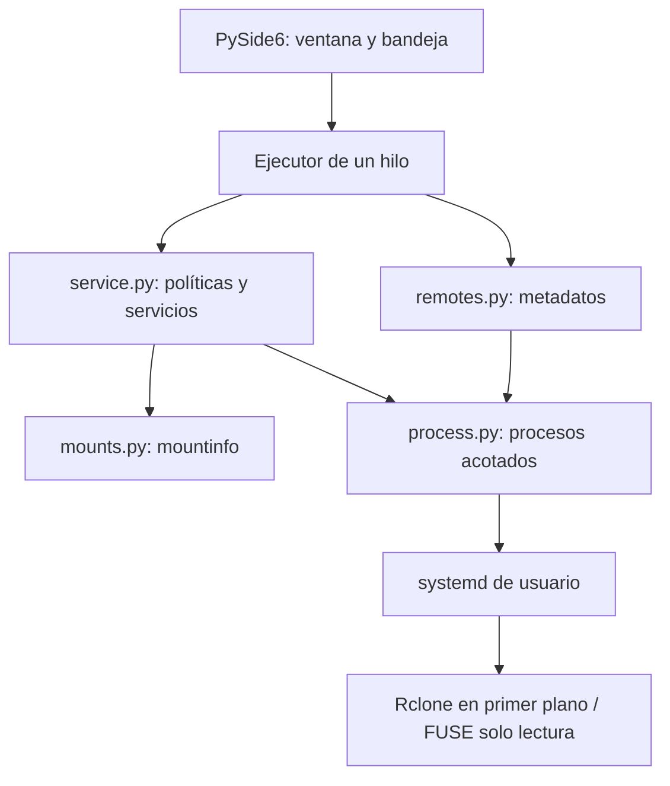

# Arquitectura propuesta y evolución

## MVP implementado

| Módulo | Responsabilidad |
| --- | --- |
| `app.py` | Interfaz Qt, bandeja, catálogo ES/EN, confirmación y sondeo; sin bloqueo del hilo gráfico |
| `remotes.py` | Descubrimiento usando `listremotes --json`; solo metadatos, nunca `config dump` |
| `mounts.py` | Lectura de `/proc/self/mountinfo`, decodificación de rutas sin recorrer FUSE |
| `service.py` | Identidad por cuenta, comprobación de propiedad, bloqueo, copia privada y servicios transitorios |
| `process.py` | Invocaciones sin shell, tiempos máximos y errores sin salida sensible |
| `packaging/` | Lanzador KDE y receta RPM sin scripts que activen servicios |

Estado: desmontado → iniciando → montado. Los fallos de systemd producen estado fallido. Un montaje o servicio ajeno produce estado externo y bloquea el montaje propio. Solo un montaje FUSE cuya fuente, ruta y servicio cumplen la política permite desmontar, con confirmación.

Los servicios son transitorios y no se escriben unidades permanentes ni se hace daemon-reload. No se cambia la configuración de otras herramientas. stdout/stderr se suprimen deliberadamente; esto limita el diagnóstico y evita persistir secretos. La configuración privada usa permisos Unix, no cifrado: protege frente a otros usuarios, no frente al mismo usuario o root.

## Próximas fases — diseñadas, no implementadas

1. `settings.py`: preferencias XDG propias, escritura atómica 0600, validación de rutas y tamaño/edad de caché por conexión. No mezclar preferencias con secretos OAuth.
2. `vfs.py`: canal RC autenticado exclusivamente local, secretos fuera de argumentos/logs, monitorización de archivos abiertos, cola, errores y subidas en curso. Bloquear desmontaje si no se puede comprobar el estado. Diseñar la coordinación con nuevas escrituras: una lectura puntual de la cola no elimina carreras.
3. `accounts.py`: crear conexiones nuevas con nombres independientes y OAuth mediante navegador externo. Reutilizar Rclone; no sustituir credenciales existentes. No incorporar esta fase sin revisar antes el diseño de almacenamiento.
4. `recovery.py`: diferenciar red caída, autenticación caducada y FUSE obsoleto; reintentos con espera creciente y límites. Nunca relanzar sobre un montaje existente.
5. `autostart.py`: unidades propias persistentes y activación por cuenta bajo acción explícita del usuario. No activar linger ni reemplazar unidades ajenas automáticamente.
6. Internacionalización: extraer el catálogo actual a Qt Linguist `.ts/.qm`, añadir selector de idioma y traducir errores por código estable.

## Fuentes técnicas

- [Rclone listremotes](https://rclone.org/commands/rclone_listremotes/): metadatos, tipo y origen.
- [Rclone mount](https://rclone.org/commands/rclone_mount/): FUSE, modo de caché y restricciones de lectura.
- [Rclone RC](https://rclone.org/rc/): estadísticas VFS para la futura escritura.
- `systemd-run --help` y `systemctl --help` del sistema Fedora 44: servicios transitorios de usuario.

## Cambio 1.0.1

`Manager.cache_directory()` añade un directorio privado por cuenta y rechaza enlaces simbólicos en la ruta de caché. `mount()` utiliza VFS full con solo lectura, UMask 0077 y parámetros de limpieza fijos. `owned()` reconoce los servicios de solo lectura tanto de 1.0.0 (off) como de 1.0.1 (full), conservando la obligación de confirmar la parada. No se han implementado aún preferencias configurables, escritura ni reinicio automático de montajes activos.

## Cambio 1.0.2

`settings.py` aporta `Preferences` y `Settings`: esquema de valores, validación de rutas, archivos independientes por cuenta y persistencia atómica privada. `Manager.save_preferences()` usa el mismo bloqueo entre instancias que montaje/desmontaje y rechaza cambios en cuentas activas. La ruta configurada cambia el destino de montaje sin cambiar el nombre de unidad ni la caché. La UI usa un diálogo traducido con selección de carpeta y controles numéricos. La fase de preferencias básicas está implementada; OAuth, escritura, montaje automático y caché en una ruta configurable siguen pendientes.

## Versión 1.1.0

- `accounts.py`: configura una cuenta Drive con Rclone en un archivo temporal privado, OAuth en navegador externo y cancelación mediante Event. Solo tras completar autorización se registra el archivo por cuenta. Los procesos no emiten logs ni tokens y tienen diez minutos de plazo. No se implementa OAuth propio ni se cambian conexiones existentes.
- `Manager.discover_accounts()`: une metadatos de conexiones existentes y archivos propios, rechazando nombres ambiguos. `snapshot_config()` usa directamente la configuración privada para las cuentas nuevas y conserva el mecanismo de copia para conexiones externas.
- `autostart.py`: genera el lanzador gráfico propio al activar preferencias y ofrece una ejecución sin ventana con `drive-manager --automount`. Cada montaje sigue perteneciendo a un servicio transitorio de systemd de usuario. No se habilitan unidades ajenas ni se fuerza desmontaje.
- `Preferences.automount`: opción persistente por cuenta, compatible con JSON de versiones anteriores.
- UI: asistente nombre/carpeta/automontaje, estado de espera y cancelación. El navegador elige la identidad Google; el nombre es una etiqueta local, no verificación de identidad.

El bloqueo de operaciones se mantiene durante el alta para impedir OAuth simultáneo en dos instancias. Las preferencias se guardan antes de promover el archivo autorizado; si falla la promoción se retiran las preferencias nuevas y se actualiza el lanzador. Los archivos temporales no forman parte del descubrimiento. Un cierre forzado del sistema puede dejar archivos `.oauth-*` privados sin registrar; no se cargan automáticamente.

Esta fase implementa el alta y automontaje propuestos. Siguen pendientes: unidades compartidas, revocación/eliminación desde la interfaz, reintentos de red al iniciar sesión y escritura segura con monitorización VFS.

## Corrección 1.1.1

Apertura OAuth explícita mediante Qt y botón para reintentar. Extracción de enlace local desde salida temporal de Rclone sin logs ni presentación de tokens; búfer acotado y errores persistentes. 40 pruebas aprobadas. No se han detenido servicios ni realizado consentimiento Google real durante esta corrección.

## Corrección 1.1.2

Se corrige la longitud mínima del estado OAuth: Rclone real emite 22 caracteres para 128 bits. 41 pruebas aprobadas y prueba de enlace/cancelación con Rclone 1.74.3 real, sin abrir navegador ni conceder acceso a Google. El callback recibió el enlace y se limpiaron los temporales.

## Versión 1.2.0

El botón de nueva conexión inicia OAuth directamente. `begin_authorization()` genera una identidad temporal y devuelve las credenciales privadas preparadas. El formulario de nombre/carpeta aparece después; guardar promueve y renombra la conexión sin repetir OAuth. Cancelar descarta el temporal. 43 pruebas aprobadas, incluyendo la secuencia Qt y el registro en dos fases. No se detienen servicios activos.

## Versión 1.3.0

`disconnect()` conserva credenciales y puede desactivar el inicio automático bajo confirmación. `remove_connection()` aplica el bloqueo de operaciones, solicita alcance explícito para conexiones externas y verifica desmontaje antes de eliminar metadatos. La UI identifica origen y confirma la operación. No se borran archivos de Drive ni carpetas locales. 51 pruebas aprobadas con archivos temporales y procesos simulados; ninguna conexión real se eliminó durante el desarrollo.

## Versión 1.4.0

`providers.py` define proveedores y flujos: Google Drive por navegador, Internxt por credenciales y OneDrive reservado. `internxt.py` configura Rclone por RC en socket Unix privado y maneja 2FA. `wallet.py` guarda una clave común en KWallet sin argumentos secretos. Las configuraciones Internxt se cifran antes de introducir credenciales; `Accounts` descubre sus nombres mediante metadatos privados y `Manager` añade password-command al montaje. Los nombres Internxt se fijan antes de autenticarse y no se renombra texto cifrado.

59 pruebas aprobadas y prueba adicional con Rclone real del cifrado y canal Unix usando datos sintéticos, sin cuenta Internxt real. Pendiente aceptación de KWallet, login, 2FA y navegación con un plan compatible. No se modificaron credenciales ni servicios activos del usuario.

## Versión 1.5.0

OneDrive se activa en `providers.py`. `onedrive.py` ejecuta la máquina de estados no interactiva de Rclone, separa JSON de stdout y avisos de stderr en memoria, envía el enlace OAuth validado a Qt y procesa únicamente la elección de unidades `config_driveid`. Se limita a OneDrive personal/business, con scopes de lectura; SharePoint queda fuera. `begin_authorization()` despacha por proveedor y conserva el flujo Google anterior.

65 pruebas aprobadas y comprobación real del enlace OAuth de OneDrive/cancelación con Rclone 1.74.3, sin consentimiento ni cuenta Microsoft real. Pendiente aceptación del login, selección de unidad y apertura de documentos de la cuenta del usuario.

## Versión 1.6.0

`Preferences.writable` mantiene compatibilidad con versiones anteriores (false por defecto). El alta solicita scopes de escritura solo cuando se selecciona ese modo; no se sustituyen tokens de perfiles existentes de lectura. `account_list.py` presenta una tabla nativa con selección de cuenta.

`transfers.py` valida estadísticas de uploads por socket Unix privado y metadatos persistentes Dirty. La escritura usa caché propia y unidades con descripción diferenciada. `stop_managed()` exige cola limpia, caché limpia y ausencia de archivos abiertos, desmonta FUSE sin force/lazy y revisa la caché después. Eliminar y pasar a lectura se bloquean con datos pendientes, conservando credenciales y caché para reconectar. No se usa inUse como contador de archivos abiertos: es el contador de referencias VFS de Rclone; se utiliza fuser y el desmontaje normal.

79 pruebas aprobadas y prueba real de VFS con subida de datos sintéticos a backend local, comprobando cola, Dirty, finalización y contenido. Pendiente aceptación FUSE y escritura en nubes reales. No se modificaron servicios activos ni credenciales del usuario durante el desarrollo.

## Versión 1.7.0

`Progress` y `Transfer` son DTO inmutables construidos en memoria a partir de vfs/stats y core/stats, con validación de números y estados. No se persisten nombres de archivos ni errores originales. `Status` incorpora el progreso para el controlador Qt. La interfaz presenta las transferencias activas y actualiza la tabla/bandeja sin afirmar conectividad a partir de un montaje local o cola vacía. El sondeo es silencioso y las acciones durante un sondeo se serializan.

87 pruebas aprobadas, incluyendo estados/errores históricos, nombres sin caracteres de control, porcentaje/velocidad/ETA no disponibles, fallo de monitor y presentación Qt. Prueba adicional con Rclone real y backend local verifica estado pendiente y finalización. No se modifican datos de cuentas reales ni se detienen servicios activos durante el desarrollo.
