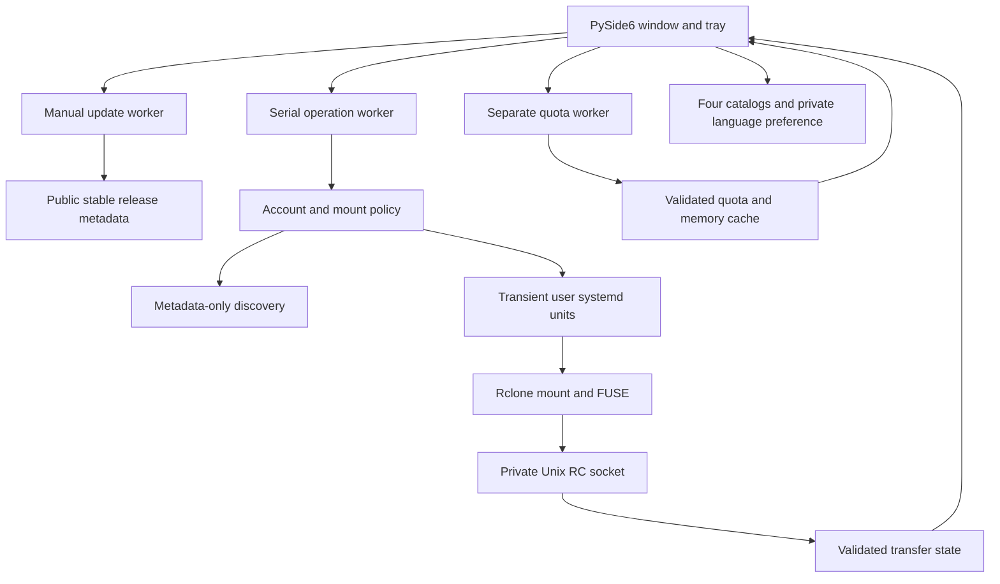

# Architecture

## Runtime flow

| Module | Responsibility |
| --- | --- |
| `app.py` | Qt widgets, selection, explicit confirmations, workers and tray integration |
| `account_list.py` | Native account/transfer tables with stable selection helpers |
| `service.py` | Account identity, ownership checks, operation lock, private snapshots and mount policy |
| `process.py` | Bounded subprocess execution without a shell or raw-output errors |
| `remotes.py`, `providers.py` | Metadata discovery and provider registry |
| `accounts.py`, `oauth_output.py` | Private registration staging, browser links and safe OAuth parsing |
| `onedrive.py` | Noninteractive authorization state machine and drive selection |
| `internxt.py`, `wallet.py` | Encrypted configuration and private Unix RC authentication with KWallet |
| `settings.py`, `autostart.py` | Private account preferences and optional graphical login launcher |
| `mounts.py` | Parse mountinfo without recursively inspecting mounted folders |
| `transfers.py` | Validate VFS statistics, dirty cache metadata, open-file protection and progress |
| `diagnostics.py` | Allowlisted local checks and safe reports |
| `notifications.py` | Per-account event deduplication and persistent mute preference |
| `updates.py` | Manual public-release checks with safe links and no installation |
| `quota.py` | Isolated, bounded capacity queries and numeric validation |
| `i18n.py`, `messages*.py` | Four complete UI catalogs, language persistence and Qt standard buttons |
| `packaging/` | KDE launcher and Fedora RPM recipe without activation scripts |

## Mount ownership and safety

States are unmounted, starting, mounted, failed or external. A matching namespace
alone is insufficient for ownership: service description, command, mount source,
mount path and FUSE type are checked. External services are neither adopted nor
stopped. Transient units avoid permanent unit files and daemon-reload.

The operation lock serializes account and mount mutations across application
instances. It cannot prevent races with other tools. Read/write mounts use a
separate durable cache and private Unix RC socket. Disconnect requires a known
empty upload queue, clean cache and closed files, followed by normal FUSE unmount.
The cache is checked again after unmount. Forced and lazy unmount are never used.

Unknown upload state blocks removal and switching to read-only. Closing the GUI
leaves mounts running. Mounting at login is opt-in and does not enable linger.

## Credentials

Existing configurations are copied for managed mounts so token refresh does not
rewrite the original file. New connections have independent private files.
Registration and reauthorization stage credentials before promotion. Failed or
cancelled OAuth preserves the original connection. OneDrive checks the drive
identity; Google requires explicit same-account selection by the user.

Internxt configurations are encrypted before credentials are submitted over a
private Unix socket. KWallet stores the encryption key. Secrets are not passed as
command arguments, logged or included in reports. Private permissions protect
against other users, not against the same user or root. Cache contents are not
application-encrypted.

## Responsiveness and languages

A serial worker handles operations and quiet polling. A separate bounded quota
worker prevents network quota queries from blocking actions or transfer updates.
Results for an old selection cannot replace a newly selected account's display.
A separate manual-update worker consults public GitHub metadata without blocking
account operations or transfer monitoring.

Language changes only update UI text and translators; they do not restart workers,
replace selections, reauthorize accounts or change services. Preferences are private
atomic JSON files. Catalog keys and interpolation fields are checked across all
four languages. Standard Qt button translations have a built-in fallback.

## Remaining scope

Shared service management, automatic forced recovery, custom OAuth-client renewal,
SharePoint selection and background quota access to locked external encrypted
configurations are not implemented. Network retries inside Rclone do not imply
automatic service restart by the application.

Technical references: [Rclone mount](https://rclone.org/commands/rclone_mount/),
[Rclone RC](https://rclone.org/rc/), [Rclone about](https://rclone.org/commands/rclone_about/).
